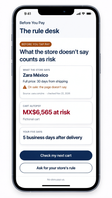
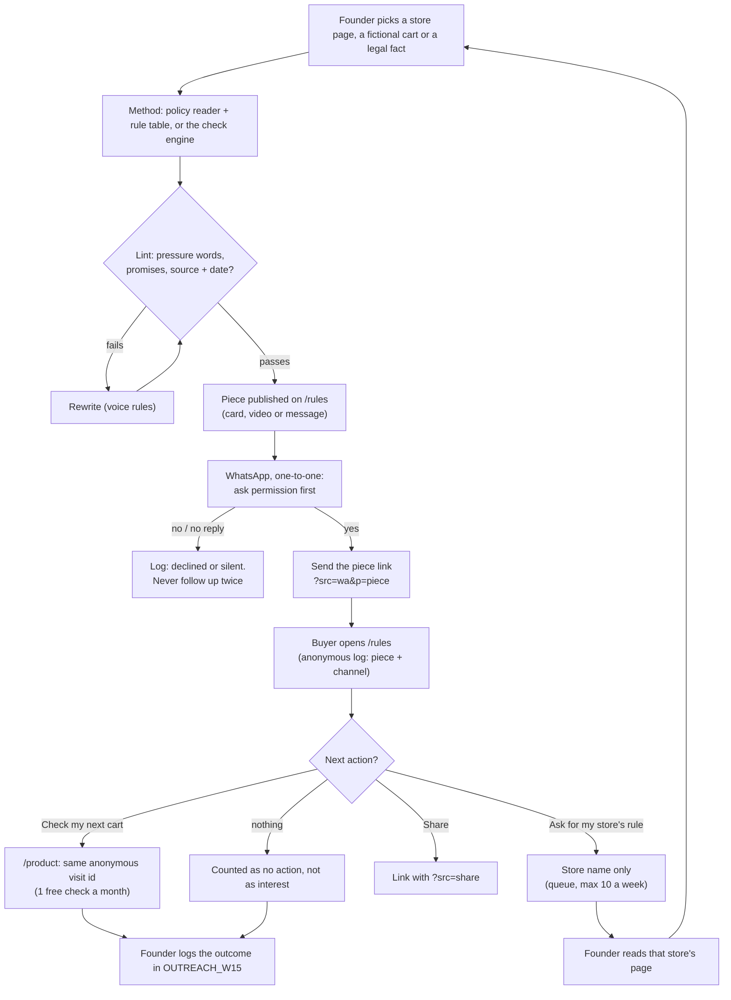
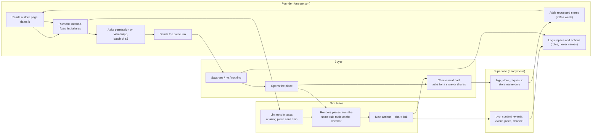

# PACKET — Before You Pay (Week 15 · Distribution: your method feeds your audience)

**Founder:** Karom Asael González Martínez · Team 5 · Operator this week
**Venture:** Before You Pay, live at **beforeyoupay.xyz**. See [`CHARTER.md`](CHARTER.md) and [`PERSONAS.md`](PERSONAS.md). Earlier packets: [`w12/`](w12/PACKET.md), [`w13/`](w13/PACKET.md), [`w14/`](w14/PACKET.md).
**This packet is also the Week 15 launch playbook** (section 12), as the updated closeout instructions ask: one packet, one demo, one playbook.

**Team 5 Week 15 Blueprint conditions this build must honor:**

1. Start with the actual user, task, need moment and decision owner; distinguish observed behavior, founder hypotheses and simulated examples.
2. Use permission-based outreach and a useful, bounded next action. Compare channels with the same offer and account for staff time and delivery capacity.
3. Count the meaningful action for each venture; do not substitute views, praise, a signed promise without use, or one purchase for validated recurring demand.
4. **Shadow clause:** do not manufacture confidence, pressure or exploit personal data: no … misleading return guarantee.
5. Respect consent and minimize personal data; keep clear records and uncertainty visible; do not publish … customer carts without authorization.
6. (Live session) peers describe each venture first; record the mismatch and the founder's response.

**My declaration:** *send dated, sourced examples to opted-in buyers in manageable batches and log actual next actions* (Conditions 2, 3, 5).

---

## 1. Problem, in my words

Before You Pay works and has a price, but nobody can find it. Last week's Buen Fin offers proved the reverse of what a feed would reward: the one person who paid MX$60 was a classmate who had **already lost money** the way I did. Attention for this product is earned **at the regret**, when a discounted order arrives in the wrong size, and the product is used **at the next cart**. So the content can't be ads or tips. It has to be the product's own output (a store's dated rule, a cart taken apart, what the law gives you after delivery), sent one-to-one to people who said yes, with a next action that works and that one founder can actually serve.

## 2. Exact user, the moment, and who pays

- **First audience (observed + persona):** university buyers like Diego (21): read English, buy discounted clothes with codes in sale seasons, and today *ask a friend before paying; if the friend doesn't know, they look for someone who can guide them* (Week 15 brief). Evidence: this week's price round (5 WhatsApp offers → 1 paid MX$60, 3 said yes without paying, 1 said no because he buys in physical stores).
- **The moment:** (a) the **regret**, when the package arrives and LFPC Art. 56's five business days start; (b) the **next sale cart**, when they'd send the screenshot to a friend. Not "ten seconds before paying": no channel reaches that moment.
- **User = payer:** the buyer, at Week 14 prices (1 free check a month; MX$60 for four; MX$49 for 30 days). A card issuer stays a bet.
- **Second, later:** Rocío (51, Spanish, WhatsApp) with guided one-to-one help, capped at five people. Not this week's build (no Spanish UI yet).
- **Not targeted:** stores, brands and marketplaces (never pay, never appear); people who buy in physical stores; people who want to be told which size to buy.

## 3. Success definition

> Before the module closes, at **beforeyoupay.xyz/rules**, a buyer who opens a link from WhatsApp sees **three dated, sourced pieces** (a store rule card, a fictional cart autopsy video and a five-days message), each one passing the **pressure-and-promise lint** in code, plus three labeled sketches; can do one of **two working next actions** (check their next cart, or ask for their store's rule) and share a piece; an **anonymous log** records which piece and which channel led to which action, with no personal data; the reader no longer blames the buyer's screenshot when it's merely busy; and **two pieces have been sent to real opted-in buyers**, with every reply, action or silence logged against what I expected.

## 4. Mockup (image-generated)

Generated with Canva's image generator ([open in Canva](https://www.canva.com/M/MAHbq62sDcQ)). Only the 112 × 198 px preview could be exported (the full 1536 × 2720 file is behind a login), so it is shown small. Image-generation prompt used:

> *Clean flat UI mockup of a mobile phone screen (iPhone, portrait) for a web app called "Before You Pay", page title "The rule desk". Navy blue (#13294b) and white design with one amber accent (#b45309), rounded cards, plenty of white space, sans-serif type, English text. Top: small amber label "Before you tap Pay" and a navy headline "What the store doesn't say counts as risk". Below, three stacked cards, each with a small series tag: card 1 tag "What the store says" titled "Zara México" with two rows "Full price: 30 days from shipping" and "On sale: the page doesn't say" and a tiny grey line "Source: zara.com/mx · checked Nov 22, 2026"; card 2 tag "Cart autopsy" with a big red number "MX$6,565 at risk" and a small grey label "Fictional cart"; card 3 tag "Your five days" with a short line "5 business days after delivery". At the bottom, a wide navy button "Check my next cart" and a white outlined button "Ask for your store's rule". A small grey footer line: "No store pays us."*

## 5. The flow (Mermaid)

### Flowchart: from a store's page to a buyer's next action

### Swimlane: who does what

## 6. Benchmark line

- **The best existing solution on Earth for this is** MoneySavingExpert (UK): it reviewed 400+ retailers' websites, found 30 implying shoppers had fewer return rights than the law gives, and 28 corrected their pages; its weekly email reaches millions and no company pays to appear.
- **Mine differs or localizes by** checking Mexican store pages against LFPC Art. 56's five business days, delivering one-to-one on WhatsApp instead of a broadcast list, and making every piece with the same engine the buyer can run on their own cart, with no affiliate links at all.

## 7. The long view (3 years)

If this slice works, the rule desk becomes the Charter's vision: a public, dated, correctable registry of the return rules of the stores Mexicans actually buy from, where every piece adds a row and buyers' requests decide which store is next. Distribution keeps happening where the screenshot already travels (a WhatsApp share), and the content stays the product demonstrating itself. That's why this week's load-bearing walls are a single rule table for the checker and the pieces, a lint that blocks pressure and promises, and an anonymous log by piece and channel.

## 8. Scope cut (what I am NOT building this week)

- No public social account, no paid ads, no follower goal (the updated rules accept a shareable venture page with opt-in outreach).
- No automated WhatsApp sending, bot or broadcast list: the founder sends one-to-one, by hand, after permission.
- No email list or newsletter sign-up; no tracking pixels, no retargeting.
- No Spanish UI (Rocío's guided path waits).
- No order-confirmation reader for the regret moment (a bet, not built: we don't sell what doesn't exist).
- No real buyer carts as content (Condition 5): only store pages, fictional carts labeled as fictional, or my own purchase.
- Only one store re-checked (Zara); El Palacio de Hierro and the others stay sketches until someone asks.

## 9. Architecture + stack

| Layer | Choice | Notes |
|---|---|---|
| App | Next.js 15 (App Router), TypeScript, Tailwind 4 | Same repo; new route `/rules`, component `RuleDesk`. |
| Hosting | Netlify (free plan) | Real domain beforeyoupay.xyz. Docs-only commits skip deploys (`[skip netlify]`) to save credits. |
| Content | `lib/content.ts` | Pieces, series and sketches as data; the Zara card reads its numbers from `RETURN_RULES`, the same table the checker uses. |
| Lint | `lib/content.ts` · `lintText()` | Pressure patterns + the engine's `BANNED` words + promise patterns + "source and date present". Tests fail the build's checks if any finished piece fails. |
| Assets | `public/rules/` | Rule card PNG (1080 × 1350) rendered from the rule row; autopsy video MP4 (1080 × 1920, H.264, ~30 s, no audio); five-days message as plain text. |
| Data | Supabase Postgres + RLS | New `byp_content_events` (anonymous: visit id, event, piece, channel) and `byp_store_requests` (store name only). Insert-only for the public key; no reads. |
| Reader | Gemini Flash-Lite (unchanged) | New: a rate-limit or timeout returns "busy, try again in a minute; your free check wasn't used" instead of blaming the screenshot. |
| Outreach log | `docs/OUTREACH_W15.md` | Batches, permission asks, pieces sent, replies and actions, by role, never names. |

**Security floor:** no secrets in the repo (Gemini key in Netlify env); the new tables hold no personal data and accept anonymous inserts only, with RLS on and no select policy; every form input is length- and character-checked in the browser and again by CHECK constraints; no real person's data in demos (the autopsy cart is fictional).

## 10. Test plan

| # | Test | Pass when |
|---|---|---|
| T1 | `/rules` on a phone (390 px) | All three finished pieces visible, sketches labeled "Sketch", no horizontal scroll. |
| T2 | Source + date (unit) | Every finished piece has a source and a check date no older than 30 days. |
| T3 | Lint (unit) | Every finished piece passes; the "before" draft in section 12.2 fails with named reasons. |
| T4 | Single source of truth (unit) | The Zara card's facts equal Zara's row in `RETURN_RULES`. |
| T5 | Channel tags | WhatsApp links carry `?src=wa&p=…`; the share button produces `?src=share&p=…`. |
| T6 | Anonymous log (live) | Insert works with the public key; select is refused; a bad event name is refused. |
| T7 | Store request (unit + live) | "Liverpool" accepted; empty, 1 character, 61+ characters, ``, `www.mi-tienda.com` and an 80-character name → `400` from the database. |
| T8 (re-test, live) | **Pass.** One anonymous visit, read in the dashboard: `rules_view` → `piece_view (zara)` → `store_requested` → `check_clicked` on `/rules`, then `page_view` on the checker one second later, same visit id `xg5k2v4f3c` (`docs/w15/t8_visit_join.png`). One row (`card_opened`) is my direct API insert from T6, not a click. All test rows are `src = direct`, so they never count as WhatsApp. |
| T10 | **Pass, live:** the autopsy video plays inline and muted (H.264, 28.5 s, 673 KB). Screenshot: `docs/w15/t10_video_playing.png`. |
| Persona | **Bug 3 (worst confusion), fixed and redeployed:** Diego, who already paid, had no path from the Zara card to what he could do now, and would quit. Store cards now link to *Your five days*, which moved right after the stores. See [`PERSONA_W15.md`](PERSONA_W15.md). |

## 12. Launch playbook

### 12.1 Audience, positioning, evidence, and the promise I won't make

| | |
|---|---|
| **Audience** | University buyers like Diego (section 2): sale-season, discount codes, English readers, already in my WhatsApp. |
| **Positioning** | *The one who does know.* Today Diego sends his cart to a friend and asks "can I return this?". Before You Pay answers with the store's own words, the date I checked them and the pesos at risk, before he pays. |
| **Evidence (observed)** | 5 WhatsApp offers in Buen Fin → 1 paid MX$60, 3 said yes without paying, 1 said no (buys in stores). The payer had already lost money on a discounted order. Their carts run MX$1,000 or more, so a MX$15 check is 1.5% of what's at stake. Two real phone sessions in Week 13. |
| **Evidence (hypothesis)** | That a dated rule or a five-days message, sent after permission, leads to a check or a store request. That's what section 12.7 tests. |
| **Promise I won't make** | "It will fit." "You can return it." "It's safe." "You'll get your money back." "We'll save you money." The lint in `lib/content.ts` blocks these words in every piece. |

### 12.2 Voice

Three rules, each one checked by code where code can check it:

1. **Quote the store, date it, link it.** A rule is the store's own words with the day I read them; never my summary turned into a promise. *(Code: every finished piece needs a source and a check date ≤ 30 days old.)*
2. **Unknown is unknown, and it counts as risk.** Say "the page doesn't say"; never "safe," "guaranteed," "you can return it," "it will fit." *(Code: the engine's `BANNED` words plus promise patterns.)*
3. **Calm, no urgency, one next step.** No countdowns, "only today," "last chance," exclamation marks or ALL-CAPS alarms. Every piece ends with one thing the reader can do now. *(Code: pressure patterns; the same tactics the checker flags on a checkout.)*

**Before / after (the S1 Zara card):**

> **Before** (the draft a feed rewards): *"⚠️ STOP!! Zara will NOT take back your sale items! Only today: check your cart before it's too late!!"*
> → Fails the lint: exclamation marks, "STOP" in capitals, "only today," "before it's too late." It's also **false**: Zara's page doesn't say sale items can't be returned; it says nothing about them.
>
> **After** (the published card): *"Zara México gives 30 days from the shipping date for online orders, free in a Zara store or MX$69 at a drop-off point. Discounted items: the page doesn't say, so we count them as risk. Next step: before paying for a sale item, check your cart. Source: zara.com/mx · Cómo devolver · checked Nov 22, 2026."*

### 12.3 Look

**Palette** (the site's own, one meaning per color):

| Color | Hex | Used only for |
|---|---|---|
| Navy | `#13294b` | Headlines, the wordmark, primary buttons. |
| Ink | `#16202c` | Body text. |
| Mute | `#5b6675` | Source lines, dates, labels. |
| Paper / Line | `#f7f8fa` / `#e3e6ea` | Backgrounds and card borders. |
| Amber | `#b45309` | Series tags and **"the page doesn't say"**. |
| Risk red | `#b91c1c` | **Pesos at risk** and "final sale," nothing else. |
| Green | `#047857` | Only what the store's words confirm. Never for "unknown." |

**Type hierarchy** (system sans; card sizes at 1080 px wide in brackets): series tag 12 px semibold, uppercase, amber [34 px] → headline 28–32 px extra-bold navy [76 px] → key number 40 px extra-bold, red only for money [96 px] → fact rows 16 px [40 px] → next step 15 px semibold in a navy-bordered box [38 px] → source line 12 px mute [28 px].

**Repeatable layout** (every piece, every series, same five blocks): **(1)** top bar: series tag left, "Before You Pay" right; a grey **Fictional** stamp when it is. **(2)** Headline: the store or the case. **(3)** Two or three fact rows, each value colored by status. **(4)** One **Next step** box. **(5)** Footer: source · checked date · "No store pays us" · beforeyoupay.xyz/rules.

### 12.4 Six concepts, three recurring series

| Series | Concept | Format | Status |
|---|---|---|---|
| **S1 · What the store says** | **S1-1 Zara México**: 30 days from shipping; discounted items not mentioned. | Image card (PNG 1080 × 1350) | **Finished · tested with buyers** |
| | S1-2 El Palacio de Hierro: 30 days after delivery by phone folio; excluded categories; discounted items not mentioned. | Image card | Sketch |
| **S2 · Cart autopsy** | **S2-1 Two jackets, one code**: the fictional Cumbre cart, MX$6,565 final sale, three pressure flags, one next step. | Vertical video (MP4 1080 × 1920, ~30 s, silent, captions) | **Finished** |
| | S2-2 Same item, two sizes: "buy two, return one" fails when the code makes both final sale. | Vertical video | Sketch |
| **S3 · Your five days** | **S3-1 It arrived too big**: what LFPC Art. 56 gives after delivery, and how to use it calmly. | WhatsApp text message (plain text, copy-ready) | **Finished · tested with buyers** |
| | S3-2 Counting the five business days: delivered on a Thursday → the window ends the next Thursday; weekends and holidays don't count. | WhatsApp text message | Sketch |

Three finished (one per series), three formats (image, video, text), two tested with the intended audience (S1-1 and S3-1), three sketched.

### 12.5 Input → method → useful content (S1-1)

1. **Input:** Zara México's own return page (*Cómo devolver*), read on Nov 22, 2026.
2. **Method:** the same keyword reader the checker uses (`classifyPolicyText`) gives *regular items: returnable, 30 days · discounted items: unknown*; the founder confirms against the page and updates Zara's row in `RETURN_RULES` (source, URL, check date).
3. **Lint:** the card's text passes the pressure-and-promise lint (section 12.2).
4. **Content:** the rule card is rendered from that row, so the card and the checker can't disagree. If Zara's page changes, one row changes both.

### 12.6 Channel and next action

- **Channel:** WhatsApp, one-to-one, permission first. No public profile: the updated rules accept a shareable venture page with opt-in outreach, and in two weeks a new account gathers nobody.
- **Home of the content:** beforeyoupay.xyz/rules, one page per series section, every piece with its own link.
- **Working next actions:** *Check my next cart* (1 free check a month) · *Ask for your store's rule* (store name only; up to 10 stores a week) · *Share* (a link with `?src=share`).
- **Batch size:** five people at a time, the same offer and wording for everyone in the batch, so channels and pieces can be compared (Condition 2). Capacity: I answer every reply the same day, and I never message twice without a reply.
- **Scripts and log:** [`OUTREACH_W15.md`](OUTREACH_W15.md).

### 12.7 The audience test: what I expected, what happened, what I'd change

**Who:** Batch 1, Nov 22. The four people who said yes to the Buen Fin offer (one of them paid MX$60). All known to me; logged by role, never by name. Two finished pieces sent: **S1-1 the Zara card** (image + link) and **S3-1 Your five days** (link). Full log and evidence: [`OUTREACH_W15.md`](OUTREACH_W15.md).

| Step | What I expected (written before sending) | What happened |
|---|---|---|
| Permission | 3 of 4 say yes | **2 of 4** (the payer, 14 min; one "yes", 1 min). **2 no reply**, not messaged again. |
| Opened the pieces | 2 of 3 open the link | **2 of 2 opened both pieces** on their phones, minutes after replying (4 opens in the anonymous log, `src=wa`). One open was **nudged** by me. |
| Asked for their store | 1 | **0** |
| Started a check | 0–1 | **0** |
| Shared | — | **0** |
| Praise | The most common reply | "Innovative", "perfect", "with this I won't keep losing money": logged, **not counted**. |

My own clicks were excluded: two desktop visits at 3:56 pm were me opening the links on my Mac. The audience's opens are the phone visits that match the time of each reply.

**What it means.** The method reaches people: both who answered opened both pieces within minutes. It doesn't yet move them: nobody reached a next action. Against Condition 3, this batch validates *attention from people who already know me*, not demand. Three things I didn't expect:

1. **The link is a wall for some people.** Person 2 has a data plan that only covers WhatsApp and social apps. He asked if he had to open it now, and only opened it after someone shared data with him.
2. **A dated rule was heard as a guarantee.** The payer answered "with this I won't keep losing money". The page never says that, and the lint blocks it. The reader added the promise himself, which is the shadow clause (Condition 4) from the buyer's side.
3. **I was the only pressure in the batch.** When person 2 asked about opening it now, I said "preferably yes". It's logged as a nudged open.

**What I'd change (Batch 2, already written in `OUTREACH_W15.md`):**

- the message itself carries the rule, and the link is only its source;
- one line in every send: *"this tells you the risk; it doesn't get your money back"*;
- a next action that works inside WhatsApp ("reply with the store you buy from most");
- send before a sale weekend or payday, not after one;
- never answer "do I have to open it now?" with yes.
