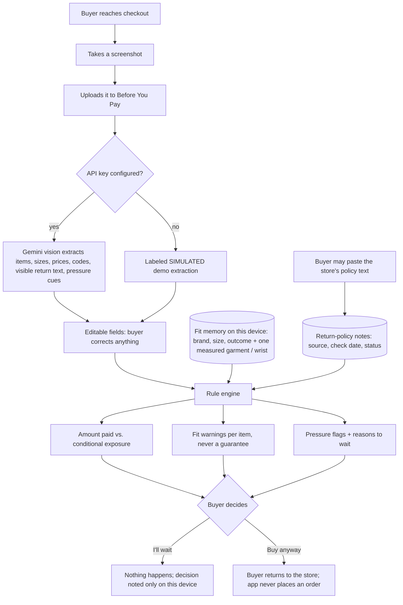
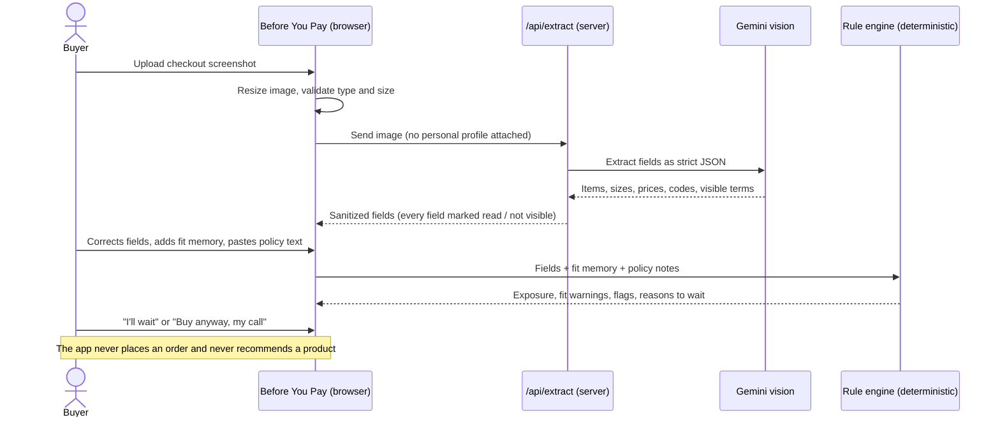

# PACKET — Before You Pay (Week 10 · Business Bending)

**Builder:** Asael González (Team 7 · Technologist this week)
**Blueprint:** Team 7, Week 10. Primary vacuum: **Regret prevention**
**My declaration:** build screenshot extraction, editable fields and conditional exposure / fit warnings. It honors Conditions **2** and **3**.

---

## 1. Problem, in my words

Online clothing stores in Mexico are built to make you pay fast. The discount code, the "last units" banner and the one-click checkout all push toward the purchase. The two things that would stop a bad purchase never show up at the moment you pay:

1. **Will this size fit me in *this* brand?** I'm an L in some brands and an M in others.
2. **What happens if it doesn't fit?** The rule that discounted items can't be returned isn't on the checkout screen.

I paid MX$6,565 for two discounted jackets in size L. Both were too big. The store refused the return because of the discount, so I bought replacements at full price on installments. The return-rate statistic never counted my regret, because I wasn't allowed to return anything.

## 2. Exact user

A Mexican online clothing buyer, 18–35, who shops from the phone and often buys **on discount, inside a short window**, without trying the item on. They know which brands have fit them before but keep that knowledge in their head, not in a tool. **They are about to pay right now.** They are not a researcher, a store, or a stylist.

## 3. Success definition

> Before the module closes, a buyer can upload a checkout screenshot (or use the labeled fictional demo) and, in under a minute, see: every item, size and price read from the image and **editable**; the **amount paid** separated from the **conditional exposure** (money stuck if the size fails and the return isn't confirmed); a **fit warning per item** based on their own fit memory; the **source, check date and status** of every return-policy finding; and a **"Wait" or "Buy anyway, my call"** choice. The app never places an order. All of this works at a live URL.

## 4. Mockup (image-generated)

`docs/mockup.png`, generated with my LLM's image generation from this prompt:

> *Mobile web app screen, clean and calm, white background, navy accents. Title "Before You Pay". At the top, a checkout screenshot thumbnail. Below it, an editable table of two jackets (name, brand, size L, price paid in MXN). Then two big number cards side by side: "Amount paid MX$6,565" and "Conditional exposure MX$6,565 — returns not confirmed". Then amber warning cards: "Last time L in this brand was too big for you", "Discount may remove your return option", "Two similar items in cart". Each warning has a small source and date tag that reads "unverified" or "advertised". At the bottom, two buttons: "I'll wait" (primary) and "Buy anyway — my call" (secondary). No product recommendations, no ads.*

## 5. The flow (Mermaid)

### Flowchart

### Swimlane: who does what

## 6. Benchmark line

- **The best existing solution on Earth for this is** True Fit (U.S.), which recommends a size by comparing a new item with the garments a shopper already owns and keeps, across brands.
- **Mine differs or localizes by** running on the **buyer's** side from a screenshot of *any* store or social-feed checkout (True Fit is paid for and embedded by the retailer), and by pairing fit with the **money at risk under the store's return rule**, the part that cost me MX$6,565.

## 7. The long view (3 years)

If this slice works, Before You Pay becomes the buyer's personal fit and risk ledger for Mexico: a fit memory that follows the person across every brand, plus a public, dated, correctable registry of store return rules built from buyers' own evidence. It would plug into a share-sheet so the check happens inside Instagram or TikTok checkouts, where 51% of Mexican online shopping already happens. It stays funded without sales commissions, so the most common correct answer it gives can still be "wait."

## 8. Scope cut (what I am NOT building)

- No store, no product recommendations, no "similar items", no affiliate links (forbidden zone + shadow clause).
- No placing orders or connecting to any store account.
- No budget form or coverage questionnaire (Valeria's declaration), no evidence-card registry or appeals workflow (Inés's), no manipulation scoring (Regina's).
- No body photos, no purchase-history import, no database, no accounts.
- No size *prediction* model: fit output is a warning based on the buyer's own evidence, never "this will fit."
- No real store policy is claimed as verified; unknown stays unknown.

## 9. Architecture + stack

| Layer | Choice | Why |
|---|---|---|
| Framework | Next.js 15 (App Router, TypeScript) | Same stack as my previous ships; one repo, one deploy |
| Hosting | Vercel (free) | Auto-deploy on every push |
| Vision + LLM | Google Gemini (`gemini-2.5-flash`) via `@google/genai`, server-side route | Free tier, reads screenshots, strict JSON output |
| **User-constraint data** | Fit memory (brand, size, outcome, one measured garment, wrist cm) in the browser's localStorage, with a "Delete all" button | Dragon Stack requirement without storing personal data on a server (Condition 5) |
| Policy data | Small curated file `lib/policies.ts` + buyer-pasted policy text classified by keyword rules | Every finding shows source, check date, status (Condition 2) |
| Logic | Deterministic rule engine `lib/rules.ts` | Exposure and warnings are explainable and testable, not LLM guesses |
| Secrets | `GEMINI_API_KEY` in Vercel environment variables only | Security floor #1 |

**Dragon Stack:** LLM + user-constraint data (fit memory) + vision (checkout screenshot).

## 10. Test plan

| # | Test | Expected |
|---|---|---|
| T1 | Load the fictional demo | "SIMULATED" label visible; two jackets, MX$6,565 paid |
| T2 | Demo + fit memory "brand L = too big" | High fit warning on both items, wording never says "will fit" |
| T3 | Policy status "no" for discounted items | Conditional exposure = sum of discounted items; labeled "confirmed non-returnable" |
| T4 | Policy unknown | Exposure labeled "returns not confirmed"; never shown as protected |
| T5 | Edit a price in the table | Totals and exposure recalculate |
| T6 | Accessory sized "M" with no cm | High warning asking for centimeters |
| T7 | Upload a non-image or a file over 4 MB | Clear error, nothing sent |
| T8 | Paste "Promotional items cannot be returned" | Policy becomes "no", source "Text you pasted", status advertised, today's date |
| T9 | "I'll wait" / "Buy anyway" | Decision shown; no network request, no order |
| T10 | Real screenshot with key configured | Fields extracted; missing fields shown as "not visible" |
| Unit | `npm test` runs the rule engine checks | All pass |

Persona test after deploy: a synthetic buyer walks the screens and narrates where she hesitates; worst confusion fixed and redeployed.
