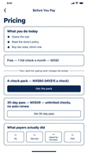
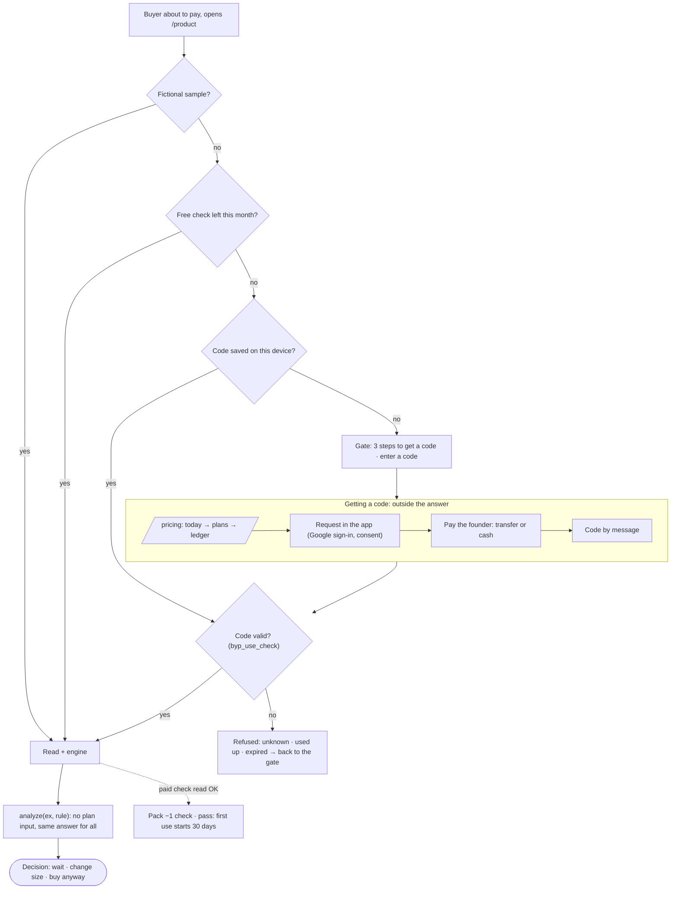
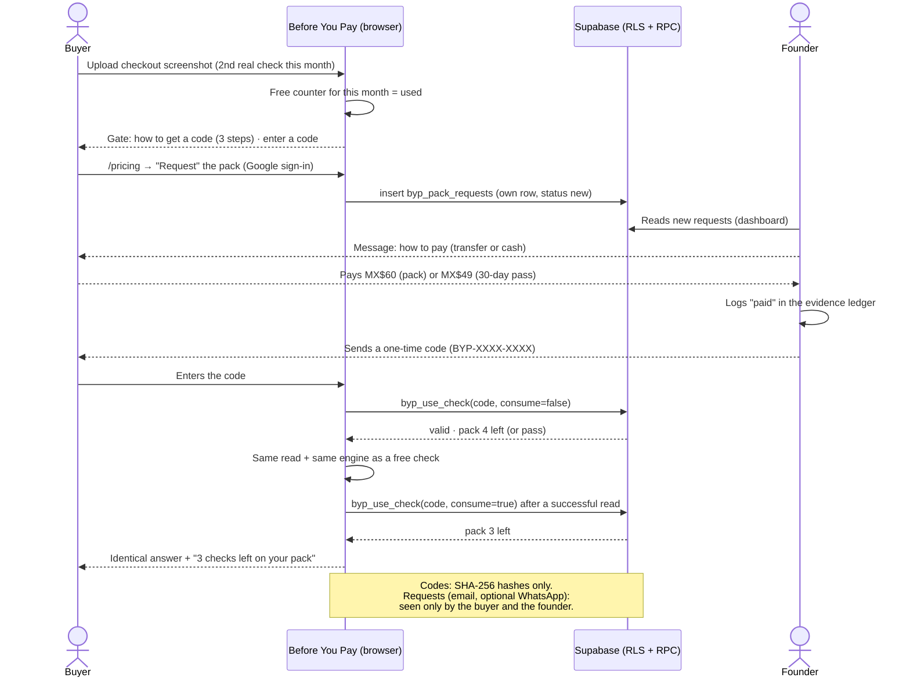
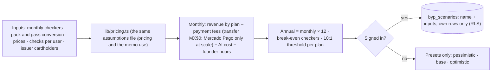

# PACKET — Before You Pay (Week 14 · Pricing: the number that tells the truth)

**Founder:** Karom Asael González Martínez · Team 5 · Money this week
**Venture:** Before You Pay, live at **beforeyoupay.xyz**. See [`CHARTER.md`](CHARTER.md) and [`PERSONAS.md`](PERSONAS.md). Earlier packets: [`w12/`](w12/PACKET.md), [`w13/`](w13/PACKET.md).
**Team 5 Week 14 Blueprint conditions this build must honor:**

1. Reconstruct the current task and alternatives **before** showing a price: buyer, budget owner, unit, full cost, next action.
2. Record **rejection, stated interest, requests and paid commitments separately**. No hypothetical yes becomes demand or revenue.
3. Compare like for like. **10:1 is a hypothesis** until real baselines are measured; show proxies and uncertainty.
4. **Shadow clause:** paying can't buy a misleading answer, a hidden ranking, access to unshared evidence or a false safety verdict. Simulations are labeled.
5. Consent, privacy, portability: document who sees what and how it is corrected or deleted.
6. A price must cover measured delivery and support; **don't sell what the current operation can't deliver.**

**My declaration:** offer five buyers the MX$60 four-check pack and record each no; free and paid answers stay identical (Conditions 2, 3, 4).

---

## 1. Problem, in my words

Before You Pay works, and it has no price. My own /about page said *"frequent buyers pay a small fee… it's a bet, not a fact yet"*: no number, no named payer, exactly this week's forbidden zone. My Brain Bending brief gave it a number built from arithmetic, not courage: the 10:1 holds for a MX$15 check from MX$625 at risk. Now the number has to live on the site in three places that agree with each other (the pricing page, a simulator and the 10:1 memo), and the site needs a way to learn whether anyone **pays**, not just says yes. So far: a friend said she'd pay up to MX$25 a check; nobody has paid.

## 2. Exact user (and who pays)

- **Segment 1 — sale-season buyer (pays per check).** An adult in Mexico on a phone, buying discounted clothes in a sale (Buen Fin, Hot Sale, January), with a guessed size. Evidence: the Week 13 Zara-app user (24) with MX$4,997 at risk. **She is buyer and budget owner**: it's her money. Unit: one check (one cart, up to 4 screenshots).
- **Segment 2 — heavy buyer or someone buying for several people (30-day pass).** About two risky carts a month or more. Evidence: me (~30 online clothing purchases a year); Rocío (51, buys for the family) in [`PERSONAS.md`](PERSONAS.md).
- **Second payer (a bet, not sold):** a card issuer offering the pass as a cardholder benefit, paid per enrolled cardholder, never per purchase.
- **Never a payer:** stores, brands, marketplaces (Charter principle 3).

## 3. Success definition

> Before the module closes, at beforeyoupay.xyz: **/pricing** first shows what a buyer does today and what it costs, then three plans (Free · 4-check pack MX$60 · 30-day pass MX$49) with the free/paid line drawn and the second payer marked as a bet; **/simulator** turns users × conversion × price into monthly and annual projections, shows every assumption tagged measured / sourced / assumed, and lets a signed-in user save, reload and delete named scenarios; **/about** carries the one-page **10:1 memo**, computed from the same assumptions file; the **free limit** (1 full check a month per device) works and a paid code unlocks exactly what was sold; the **pricing evidence ledger** shows every conversation in its own column (no · said yes · asked for the pack · paid); and a test proves **a free check and a paid check give the identical answer**.

## 4. Mockup (image-generated)

Image-generation prompt used:

> *Clean flat UI mockup of a mobile phone screen (iPhone, portrait) for a web app called "Before You Pay", page title "Pricing". Navy blue (#13294b) and white design, rounded cards, plenty of white space, sans-serif type, English text. Top: a small section "What you do today" with three short rows: "Guess the size", "Read the store's policy", "Buy two sizes, return one". Then three stacked plan cards: "Free — 1 full check a month — MX$0"; "4-check pack — MX$60 (MX$15 a check)" with a navy "Get the pack" button; "30-day pass — MX$49 — unlimited checks, no auto-renew" with an outlined button. A thin dashed line between the free card and the paid cards labeled "Free / paid line: paying never changes the answer". Bottom: a small card "What payers actually did" with four counters: "No", "Said yes", "Asked for the pack", "Paid".*

## 5. The flow (Mermaid)

### Flowchart: a check under the free/paid line

### Swimlane: who does what

### Flowchart: the simulator

## 6. Benchmark line

- **The best existing solution on Earth for this is** Consumer Reports' member-funded model: buyers pay, sellers never do (no advertiser since 1936, ~70% of revenue from ~4M paying members); for the loss itself, Amex Return Protection already refunds up to US$300 an item when a store refuses a return within 90 days.
- **Mine differs or localizes by** pricing one check at the moment of paying, in pesos, in Mexico, buyer-side, for the buyers who don't have a premium card, and by publishing who actually paid next to the price.

## 7. The long view (3 years)

If this slice works, the free check stays the honest default and paid checks fund the one thing the model can't do: keeping a sourced, dated return-rule table for the stores Mexicans buy from. The 30-day pass becomes a benefit card issuers buy per cardholder, so a buyer with a basic card gets the same check a Platinum holder would. The pricing ledger stays public, so the product's own claims about demand can be checked the same way it checks a store's claims.

## 8. Scope cut (what I am NOT building this week)

- **No in-app payments or webhooks.** Payment happens person to person, by bank transfer or cash; the founder issues a code by hand. Fine at 5 buyers; not at 500 (then a Mercado Pago link, already priced in the simulator).
- **No auto-renewing subscription.** The "monthly" plan is a 30-day pass that ends by itself.
- **Return-window alerts are not sold.** They aren't built (Blueprint Condition 6).
- **No issuer integration.** The issuer is a line on /pricing marked as a bet.
- **No server-side metering of /api/extract.** The free limit is per device in the browser; a determined user can clear it. Logged as a known limit.
- **No Spanish UI yet** (W13 pain #3, still logged).

## 9. Architecture + stack

| Layer | Choice | Notes |
|---|---|---|
| App | Next.js 15 (App Router) + Tailwind v4 on Netlify (moved from Vercel this week) | Repo `KaromBuilds/before-you-pay`, domain beforeyoupay.xyz on Netlify DNS |
| One source of truth | `lib/pricing.ts` | Plans, prices, fees, every assumption with M/S/A tag and source, `tenToOne()`, `simulate()`. Used by /pricing, /simulator and the /about memo, so the three can't disagree. |
| Evidence | `lib/evidence.ts` | Pricing conversations, each in exactly one outcome column. Roles, never names (Condition 5). |
| Free limit + codes | `lib/quota.ts` + Supabase `byp_codes` + RPC `byp_use_check` (security definer) | Codes stored as SHA-256 only; no table access through the public key. Switch: `FREE_LIMIT_ON`. |
| Saved scenarios | Supabase `byp_scenarios` (RLS: own rows only) | Google sign-in (security floor #2); name ≤ 60 chars, numeric ranges validated in the browser and in SQL. |
| Pack requests | Supabase `byp_pack_requests` behind Google sign-in (RLS: own rows; email taken from the sign-in token) | Optional WhatsApp, explicit consent, the buyer can delete it. Only the buyer and the founder see it. |
| Event log | `byp_events_v2` (v1 kept as history): pricing_view, plan clicks, gate_shown, code_ok/code_bad, paid_check, pack_requested, scenario_saved | Insert-only with the public key; no personal data. |
| AI | Gemini Flash-Lite reads the screenshot only | ≈US$0.003 per screenshot; the engine decides. |
| Secrets | `GEMINI_API_KEY` in Netlify env only (a new key; the old one stays locked in the paused Vercel team) | Supabase publishable key is public by design; RLS protects rows. |

## 10. Test plan

| # | Test | Pass |
|---|---|---|
| T1 | `tenToOne(15)` threshold | MX$625; Hot Fashion order MX$989 → 15.8:1; MX$25 → 9.5:1 |
| T2 | Mercado Pago fee | MX$15 → MX$5.25; MX$60 → MX$7.07; MX$49 → MX$6.62 |
| T3 | `simulate()` base preset | Monthly and annual add up; net = revenue − fees − AI − upkeep |
| T4 | Simulator input validation | Negative, NaN and huge values rejected/clamped |
| T5 | **Identical answer** | `analyze()` takes no plan; free and paid runs of the same cart are deep-equal |
| T6 | Free limit | 1st real check this month passes; 2nd shows the gate; sample never counts; new month resets |
| T7 | Pack code | Valid code → 4 checks, decrements only after a successful read; 5th use refused |
| T8 | Pass code | First use starts 30 days; unlimited inside; refused after expiry |
| T9 | Bad code | Unknown code refused; table not readable with the public key |
| T10 | Saved scenarios | Save, reload, delete while signed in; anonymous read of `byp_scenarios` returns `[]` |
| T11 | Ledger | Each entry counted in exactly one column; "paid" counts only real payments |
| T12 | Memo = pricing = simulator | All three read the same numbers from `lib/pricing.ts` |
| T13 | Signed-out links | /pricing, /simulator, /about open for someone not signed in |

## 11. Test → fix → redeploy (this week)

| # | Result | How |
|---|---|---|
| T1–T6, T9, T11, T12 | **Pass** (28/28 tests) | `npm test`: 10:1 thresholds, fees, simulator math and validation, identical free/paid answer, free limit, code format, ledger, one source of truth |
| T5 shadow clause | **Pass** | `analyze()` has arity 2; free and paid runs deep-equal; the checker calls only `analyze(ex, rule)` |
| T7 pack code, live | **Pass** | A test code (not one of the ten for sale): 4 → 3 → 2 → 1 → 0, then refused "used_up" |
| T8 pass code, live | **Pass** | First use set the end date exactly 30 days later; later uses keep it |
| T9/T10 RLS, live | **Pass** | Public key: `byp_codes`, `byp_scenarios`, `byp_pack_requests` all read `[]`; anonymous request insert → 401 (RLS); unknown code → "unknown"; bad format → "format" |
| Reader on the new host | **Pass** | `/api/extract` on Netlify read the fictional sample in 2.8 s with gemini-3.5-flash-lite |
| T13 signed-out links | **Pass** | /pricing, /product, /simulator, /about open on beforeyoupay.xyz in a signed-out browser |

**Bugs found and fixed:**

1. **The site was down.** The first push failed on Vercel: the whole Hobby team is paused Nov 11–Dec 11 for another project's bandwidth. Moved hosting to Netlify (free), moved the domain's nameservers to Netlify DNS, and redeployed. beforeyoupay.xyz serves from Netlify with HTTPS.
2. **Pricing comparison cut off on phones** (mechanical pass, live screenshot): the "Risk" column was off-screen. Replaced the table with cards. Redeployed (before/after screenshots).
3. **Stale free-check status after Google sign-in:** the status line could say "1 left" when it was used, because the sign-in restore returned before reading the counter. Moved the read first. Redeployed.
4. **Supabase flagged the first SQL as destructive** (it replaced a check constraint). Rewrote it so nothing is dropped: pricing events go to a new `byp_events_v2`; v1 stays as history.
5. **Persona test (Rocío):** the gate asked for a code without saying how to get one. Fixed (see [`PERSONA_W14.md`](PERSONA_W14.md)). Redeployed.

**What changed between this packet and the build** (the packet was committed before any code, commit `661434e`; this version matches what shipped):

- Payment: the packet said "the founder's Mercado Pago link." The founder has no Mercado Pago account, so the pilot is paid by **bank transfer or cash**, person to person. Fees in the pilot are MX$0; Mercado Pago stays in the simulator as the at-scale option.
- How a buyer asks: added an **in-app request** (Google sign-in, optional WhatsApp, consent, deletable) so the founder's email is not on the site.
- Hosting: **Vercel → Netlify**, because Vercel paused the whole team until Dec 11.

Pricing conversations: [`PRICING_W14.md`](PRICING_W14.md).
