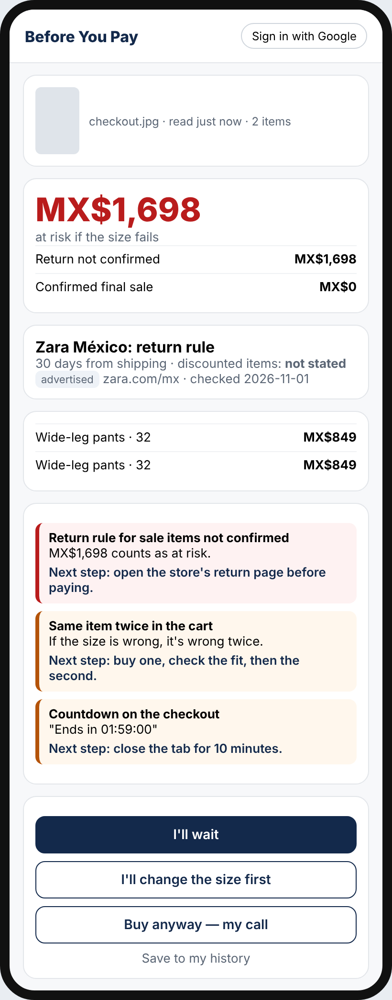
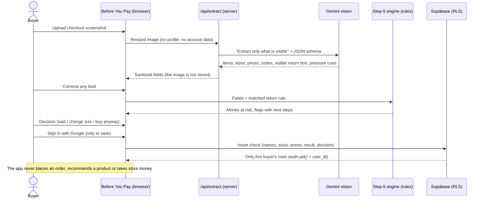

# PACKET — Before You Pay (Week 12 · Core Build)

**Founder:** Karom Asael González Martínez · Team 8 · Adversary this week
**Venture:** Before You Pay, rebuilt from my Week 10 ship (Regret vacuum). See [`CHARTER.md`](CHARTER.md) and [`PERSONAS.md`](PERSONAS.md).
**Engine sentence:** *Step 5 of my Method becomes the function that turns the checkout screenshot a buyer already has into the pesos she would lose if it doesn't fit, under that store's real return rule, before she pays.*
**Team 8 Blueprint conditions this build must honor:** (1) the AI never decides · (2) no false certainty · (3) **shadow clause:** the party the user decides against can never pay to shape the answer · (4) store the minimum, Google sign-in and RLS · (5) every warning ends in one next step.

---

## 1. Problem, in my words

Online clothing stores in Mexico are designed so you pay fast. The discount code, the "last units" banner and the one-tap checkout all push toward paying. The one fact that would stop a bad purchase isn't on the checkout screen: **what happens to your money if the size is wrong.** I paid MX$6,565 for two discounted jackets, both too big, and the discount meant I couldn't return them. This month my mother bought two pairs of Zara pants online with a guessed size. Nobody shows the buyer the money at risk before she pays, and return statistics never count the regret that was never allowed to be returned.

## 2. Exact user

An adult in Mexico buying clothes or shoes online from a phone, **at the moment before paying**, with a guessed size and often a discount code. Personas: **Rocío, 51** (buys for her family on Zara, reads slowly, distrusts apps) and **Diego, 21** (discount codes, installments, in a hurry). Not a store, not a stylist.

## 3. Success definition

> Before the module closes, at the venture's real domain, a buyer can upload a checkout screenshot (or the labeled fictional sample) and in under a minute see: every line item **read and editable**; **money at risk if the size fails**, split into *confirmed final sale* and *return not confirmed*; **the store's return rule with its source and check date**; **pressure flags, each with one next step**; and then choose **wait / change size first / buy anyway (my call)**. After signing in with Google, the check and the decision are **saved** to the buyer's own history, which only they can see and delete.

## 4. Mockup



`docs/mockup.png` is the target phone screen. Image-generation prompt (for regenerating it in my LLM's image tool):

> *Generate an image: a realistic mobile web app mockup, phone portrait, calm white background with deep navy and warm amber accents. Top bar: "Before You Pay" and a small "Sign in with Google" button. A small thumbnail of a clothing checkout screenshot. Below it, a big summary card: red number "MX$1,698" and the line "at risk if the size fails", with two smaller lines: "MX$1,698 return not confirmed" and "MX$0 final sale". A card titled "Zara México — return rule" with "30 days · discounted items: not stated · source zara.com/mx · checked 2026-11-01". Two editable item rows: "Wide-leg pants · size 32 · MX$849" twice. Three flag cards with a left color border, each ending in a bold "Next step:" line: "Same item twice in the cart", "Return rule for sale items not confirmed", "Countdown on the checkout". Bottom: three buttons, "I'll wait" (filled navy), "I'll change the size first", "Buy anyway — my call" (outlined), and a small "Save to my history". No ads, no product suggestions, no store logos. Flat, clean UI.*

## 5. The flow (Mermaid)

### Flowchart

```mermaid
flowchart TD
    A[Buyer is on a checkout, about to pay] --> B[Takes a screenshot]
    B --> C[Uploads it on /product]
    C --> D[Browser resizes and validates the image]
    D --> E[/api/extract: Gemini vision reads ONLY visible fields as strict JSON]
    E --> F[Server sanitizes: lengths, numbers, max 20 items]
    F --> G[Editable line items: buyer fixes anything]
    G --> H[Step-5 engine: deterministic rules]
    I[(Curated return-rule table: source, check date, status)] --> H
    J[Return wording visible on the screenshot] --> H
    H --> K[Money at risk: final sale + return not confirmed]
    H --> L[Pressure flags, each with one next step]
    K --> M{Buyer decides}
    L --> M
    M -- wait / change size / buy anyway --> N{Signed in with Google?}
    N -- no --> O[Result stays on screen only; offer to sign in to save]
    N -- yes --> P[(Supabase byp_checks, RLS: only the owner's rows)]
    P --> Q[/history: list, North Star 'pesos kept', delete]
```

### Swimlane: who does what



## 6. Benchmark line

- **The best existing solution on Earth for this is** True Fit (U.S.) and Zalando's size advice (Europe): they use a shopper's own garments or past returns to warn about fit before purchase.
- **Mine differs or localizes by** working on the **buyer's side from a screenshot of any Mexican store** (True Fit and Zalando live inside the retailer and are paid by it), and by showing **the pesos at risk under that store's real return rule**, which is the part that cost me MX$6,565 and is never on the checkout screen.

## 7. The long view (3 years)

If this slice works, Before You Pay becomes the pre-payment check Mexicans run inside any store, Instagram or TikTok checkout, through the phone's share sheet. Its moat is a public, dated, correctable registry of real Mexican return rules built from stores' own words and buyers' evidence. It stays funded by buyers, never by stores, so "wait" remains a valid answer.

## 8. Scope cut (what I am NOT building)

- No fit prediction and no fit memory across brands (the Week 10 fit memory is cut from the core).
- No body photos or measurements.
- No product, store or size recommendations, no affiliate links, no ads.
- No placing orders, no store accounts, no browser extension, no share-sheet integration.
- No saving the screenshot image.
- No payments or subscription this week (the "who pays" bet is tested with users first).
- No admin panel for the policy table. It's a reviewed file in the repo.

## 9. Architecture + stack

| Layer | Choice | Why |
|---|---|---|
| Framework | Next.js 15 (App Router, TypeScript) + **Tailwind CSS v4** | Course stack floor; one repo, one deploy |
| Hosting | Vercel (free), auto-deploy on push to `main` | Two or more deploys, real domain attached |
| Domain | The venture's real domain, bought with the venture's Gmail and connected to Vercel | Venture rule: the domain is the URL of record |
| Vision | Gemini Flash via `@google/genai`, server-side `/api/extract`, strict JSON schema | Reads screenshots; key only in Vercel env |
| Engine (Step 5) | `lib/engine.ts`, deterministic and unit-tested | Condition 1: the AI reads, rules decide |
| Return rules | `lib/policies.ts` curated table: store, regular/discounted returnable, window, fee, source URL, check date, status | Condition 2: unknown stays unknown |
| Auth | Supabase Auth, **Sign in with Google** | Security floor #2 |
| Data | Supabase Postgres `byp_checks`, **RLS on**, owner-only select/insert/delete, CHECK constraints on lengths | Floors #3, #4; Condition 4 |
| Secrets | `GEMINI_API_KEY` in Vercel only; Supabase URL + anon key are public by design (RLS protects data) | Floor #1 |

## 10. Test plan

| # | Test | Expected |
|---|---|---|
| T1 | Load the fictional sample | "SIMULATED" label; 2 items; money at risk shown |
| T2 | Fictional store with "final sale on discount" | Discounted items counted as *confirmed final sale* |
| T3 | Zara item with a discount | Regular rule "30 days, advertised"; discounted rule "not stated" → counted as *return not confirmed*, never protected |
| T4 | Unknown store | Every peso counted as *return not confirmed*; rule card says "No policy found" |
| T5 | Edit a price or quantity | Money at risk recalculates |
| T6 | Same item twice / qty > 1 | Duplicate flag with one next step |
| T7 | Pressure cue on the screenshot | Pressure flag quoting the cue, with one next step |
| T8 | Every flag | Has exactly one non-empty next step |
| T9 | Output text | Never contains "safe", "will fit", "guaranteed" |
| T10 | Non-image or >4 MB file | Clear error, nothing sent |
| T11 | Save without signing in | Prompt to sign in; nothing is written |
| T12 | Save signed in → /history | Check appears with decision; North Star updates; delete removes it |
| T13 | RLS | A second account can't see the first account's checks |
| T14 | Real screenshot on the live domain | Fields extracted; missing fields shown as "not visible" |
| Unit | `npm test` | All engine and policy tests pass |

Persona test after deploy: Rocío (primary). Worst confusion fixed and redeployed.
