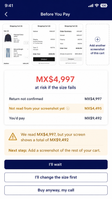
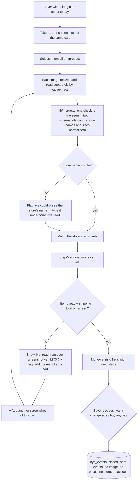
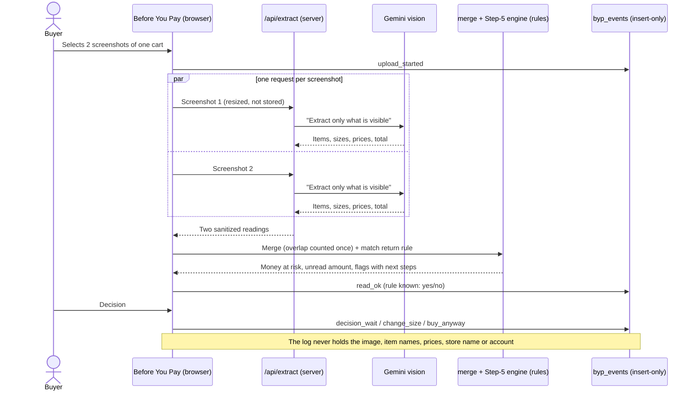

# PACKET — Before You Pay (Week 13 · Real Humans)

**Founder:** Karom Asael González Martínez · Team 8 · Technologist this week
**Venture:** Before You Pay, live at **beforeyoupay.xyz**. See [`CHARTER.md`](CHARTER.md) and [`PERSONAS.md`](PERSONAS.md). Week 12 packet archived in [`w12/`](../w12/PACKET.md).
**Team 8 Week 13 Blueprint conditions this build must honor:** (1) declared ≠ evidence · (2) complaints kept verbatim, never quietly downgraded · (3) **shadow clause:** testing never turns the user into data · (4) no false certainty · (5) the fix must move toward the moment of commitment.

---

## 1. Problem, in my words

Week 12 built the check: a buyer uploads the checkout screenshot she already has and sees the pesos she'd lose if the size fails, under that store's real return rule. This week real people used it on their own phones, and the first thing they ran into wasn't the one I expected. **Carts don't fit in one screenshot.** One user said *"no me dejó subir múltiples fotos entonces no enfoqué todo el carrito."* Another uploaded a Zara-app cart. The app read three items and said **MX$4,997 at risk**, while her own screen showed a **MX$9,492** total. The items it couldn't see simply didn't count, so the product showed *less* risk than she actually had. For a tool whose whole promise is "no false certainty," that's the worst possible failure.

## 2. Exact user

The Charter user, now with evidence: an adult in Mexico on a phone, about to pay for clothes, with **a cart longer than one screen** and often a store app that doesn't print the store's name on the cart (the Zara app). Week 13 sessions: a user buying on Amazon, and a 24-year-old buying on the Zara app.

## 3. Success definition

> Before the module closes, at beforeyoupay.xyz, a buyer with a long cart can upload **up to four screenshots of the same cart at once** (or add more after the first result). The app merges them into one check, counts a line seen in two screenshots only once, and **never shows a risk smaller than what's on her screen without saying so**: if the items read don't add up to the total, it shows the unread amount and tells her to add the rest of the cart. If no store name is visible, it asks her to type it, so the store's return rule can apply.

## 4. Mockup (image-generated)

Image-generation prompt used:

> *A realistic mobile web app mockup, phone portrait, white background with deep navy and amber accents. Top bar: "Before You Pay". Below, a row of three small thumbnails of clothing cart screenshots with a "+ Add another screenshot of this cart" dashed button. A big summary card with a red number "MX$4,997" and the line "at risk if the size fails", then smaller rows: "Return not confirmed MX$4,997", an amber row "Not read from your screenshot yet MX$4,495", and "You'd pay MX$9,492". An amber warning card: "We read MX$4,997, but your screen shows a total of MX$9,492" with a bold line "Next step: Add a screenshot of the rest of your cart." Bottom: three buttons "I'll wait" (filled navy), "I'll change the size first", "Buy anyway, my call". Flat, clean UI, no ads, no store logos.*

## 5. The flow (Mermaid)

### Flowchart

### Swimlane: who does what

## 6. Benchmark line

- **The best existing solution on Earth for this is** the EU's 14-day right of withdrawal for online purchases (Directive 2011/83/EU), which since June 19, 2026 also requires an easy electronic withdrawal button: the return right is a visible default, not fine print.
- **Mine differs or localizes by** bringing that visibility to Mexico from the **buyer's side**, before paying, for any store, from screenshots she already has, under each store's own published rule (Mexico's legal floor, LFPC Art. 56, is shorter and almost never shown at checkout), and without taking a peso from stores.

## 7. The long view (3 years)

If this slice works, Before You Pay is the check Mexicans run in the ten seconds before paying, from the phone's share sheet in any store, Instagram or TikTok checkout. It reads the **whole** cart, however long, and keeps a public, dated, correctable registry of return rules for the sellers Mexicans actually buy from (the seller, not the brand: Brownie on Palacio's site follows Palacio's rule). It's funded by buyers, never by stores, so "wait" stays a valid answer.

## 8. Scope cut (what I am NOT building this week)

- No Spanish version yet (pain #3). The fix is a real translation, not the browser's machine translation, and it's next week's test.
- No automatic store detection from logos or colors; the buyer types it when it isn't printed.
- No fit prediction, body measurements or product recommendations (Charter non-goals).
- No saving screenshots, ever. More than four screenshots per check isn't supported (yet).
- No user-facing analytics page. Events are read by the founder only, reported by day.

## 9. Architecture + stack

| Layer | Choice | Week 13 change |
|---|---|---|
| Framework / hosting | Next.js 15 + Tailwind v4 on Vercel, auto-deploy from `main`, real domain beforeyoupay.xyz | 4 deploys this week |
| Vision | Gemini Flash via `/api/extract`, strict JSON schema, one request per screenshot | Called in parallel for up to 4 screenshots |
| Merge | **`lib/merge.ts`** (new): merges readings; overlap rule with normalized names and sizes | New |
| Engine | `lib/engine.ts`, deterministic, unit-tested | New `unread` amount + `items-missing` and `no-store` flags |
| Return rules | `lib/policies.ts` | Added El Palacio de Hierro (domain + name aliases) |
| Analytics / feedback (stack floor) | **Supabase `byp_events`** (new) via `lib/track.ts`: closed list of 14 events + rule known + language + phone/desktop. Insert-only RLS for the public key; nobody can read it through the app | New |
| Auth / data | Supabase Google sign-in, `byp_checks` with RLS (from Week 12) | Unchanged |
| Secrets | `GEMINI_API_KEY` only in Vercel env | Unchanged |

## 10. Test plan

| # | Test | Expected | Result |
|---|---|---|---|
| T1 | Session-2 numbers: 3 items read (MX$4,997), total MX$9,492, no store | `unread` = MX$4,495, "items-missing" is the first flag, "no-store" flag shown | ✅ unit + live |
| T2 | Items + shipping match the total | No unread warning | ✅ unit |
| T3 | Two screenshots, one line in both | That line counts once; store and total taken from the screenshots that show them | ✅ unit + live |
| T4 | Two identical lines inside ONE screenshot | Both kept (real duplicates) | ✅ unit |
| T5 | Reader says "M" in one screenshot and "Talla M" in the next | Same line, counted once | ❌ live → fixed → ✅ |
| T6 | Palacio checkout, reader returns "elpalaciodehierro.com" | Palacio rule applies (full-price sweater: MX$1,599 → MX$0 at risk) | ✅ unit |
| T7 | Event log | Anonymous insert works; anonymous read returns `[]`; unknown event rejected (400) | ✅ live |
| T8 | All Week 12 engine tests | Still pass | ✅ 19/19 |

## 11. Test → fix → redeploy (this week)

1. **Mechanical pass (Nov 5):** my own real Palacio checkouts showed the store read as "elpalaciodehierro.com" and no rule → 100% at risk. Fixed (rule + aliases), redeployed.
2. **Real users (Nov 5):** two sessions found the long-cart pain (ranked #1). Fixed (multi-screenshot + unread warning + missing-store prompt), redeployed Nov 8.
3. **Live re-test (Nov 8):** found the "M" vs "Talla M" double count. Fixed, redeployed, regression test added.

User sessions, quotes and pain ranking: [`USERS_W13.md`](USERS_W13.md).
